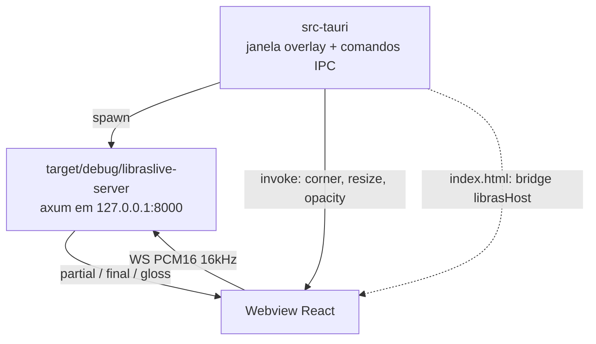

# LibrasLive

Overlay de LIBRAS em tempo real a partir do **áudio do sistema**. Captura o que sai dos alto-falantes (vídeos, reuniões, podcasts, jogos, chamadas do navegador), transcreve em pt-BR e reproduz os sinais num avatar 3D flutuante, sempre visível, sem roubar o foco.

Stack: **Rust** (Tauri 2 + axum/tokio + whisper-rs + cpal + `ort`/ONNX Runtime + rusqlite) com o avatar WebGL em **Three.js/React Three Fiber** dentro do webview. Funciona **offline** após a instalação dos modelos: nuvem nenhuma, chave de API nenhuma.

> **Aviso:** protótipo. **NÃO substitui um intérprete profissional de LIBRAS.** Veja [LIMITAÇÕES](#limitações).

---

## 1. Visão

| Camada | Tecnologia | Dono |
| --- | --- | --- |
| Shell / overlay | Tauri 2 (Rust) | Andaime |
| Captura + VAD | `cpal` + monitor PipeWire/Pulse / WASAPI loopback, Silero via `ort` (ONNX Runtime) | Eco |
| STT | `whisper-rs`, modelo `small` pt, local | Eco |
| Axum server | `axum` + `tokio`, WS `/stream`, `GET /lexicon`, `GET /health`, SQLite | Eco |
| NLP / gloss | Rust determinístico + serde, contratos da spec 6.2 | Trama |
| Lexicon | `lexicon/libras.json` (535 sinais) | Trama |
| Avatar | Three.js + React Three Fiber no webview do Tauri | Argila |
| Contratos/testes | `tests/`, `scripts/` | Peneira |
| Workspace, build, CI, docs | este arquivo + `Cargo.toml`, `src-tauri/`, `package.json` | Andaime |

---

## 2. Arquitetura

### 2.1 Fluxo de dados

```mermaid
flowchart LR
    A[Áudio do sistema<br/>PipeWire/Pulse · WASAPI loopback] --> B[Captura Rust<br/>cpal + VAD Silero/ONNX]
    B --> C[STT local<br/>whisper-rs small pt]
    C --> D[Normalização + gloss<br/>crate nlp em Rust]
    D --> E[(Lexicon<br/>lexicon/libras.json)]
    E --> F[GlossResult JSON<br/>contrato 6.2]
    F -->|WebSocket /stream| G[Webview Tauri<br/>useGlossStream]
    G --> H[Fila de animação]
    H --> I[Avatar Three.js<br/>overlay transparente]
    I --> J[(SQLite + JSON<br/>histórico e preferências)]
```



### 2.2 Processos



O `src-tauri/src/lib.rs` inicia o binário `libraslive-server` automaticamente no `setup`.
Se o binário ainda não foi compilado, ele registra o aviso e a UI entra em **modo demo**
(glossos de exemplo), então a interface funciona sem modelos instalados.

Variável de override: `LIBRASLIVE_SERVER_BIN=/caminho/para/libraslive-server`.

### 2.3 Contrato de dados

`SignPose`, `GlossToken` e `GlossResult` permanecem **idênticos** à spec 6 (serde compatível
com o JSON). Canal WebSocket:

- Cliente → servidor: binário PCM16 LE mono 16 kHz, 320 amostras por chunk (20 ms).
- Servidor → cliente: `{"type":"partial"|"final","text":"...","latency_ms":n}` e
  `{"type":"gloss","gloss":GlossResult,"latency_ms":n}`.
- `GET /lexicon` → `{ "versao": string, "sinais": SignPose[] }`.
- `GET /health` → `{ "status":"ok", "modelo":string }`.

---

## 3. Estrutura de pastas

```text
libraslive/
├── Cargo.toml                 # workspace — dono: Andaime
├── crates/
│   ├── audio/                 # captura + VAD — Eco
│   ├── stt/                   # whisper-rs — Eco
│   ├── nlp/                   # gloss + contratos — Trama
│   └── server/                # axum + SQLite — Eco
├── lexicon/libras.json        # 535 sinais — Trama
├── src-tauri/
│   ├── Cargo.toml
│   ├── tauri.conf.json        # janela transparente, always-on-top, frameless
│   ├── build.rs
│   ├── capabilities/default.json
│   ├── icons/                 # PNG + ICO reais
│   ├── src/lib.rs             # comandos IPC, startup do axum, tray
│   ├── src/main.rs
│   └── gen/android/           # manifest + foreground service
├── src/renderer/              # avatar R3F + useGlossStream — Argila
├── tests/  scripts/           # contratos e validador — Peneira
├── index.html                 # bridge window.librasHost -> invoke()
├── vite.config.ts
├── package.json
├── .github/workflows/ci.yml
└── README.md
```

---

## 4. Instalação e execução

### 4.1 Ubuntu / Linux

```bash
sudo apt update
sudo apt install -y build-essential curl wget file pkg-config \
  libwebkit2gtk-4.1-dev libayatana-appindicator3-dev librsvg2-dev libssl-dev libxdo-dev

# Rust estável
curl --proto '=https' --tlsv1.2 -sSf https://sh.rustup.rs | sh
source $HOME/.cargo/env

# Node 20 LTS
curl -fsSL https://deb.nodesource.com/setup_20.x | sudo -E bash -
sudo apt install -y nodejs

cd libraslive
npm install
cargo build --workspace          # compila tambem o binario libraslive-server

npm run tauri dev                # Vite :1420 + janela overlay no canto superior direito
npm run tauri build              # .deb e .AppImage em src-tauri/target/release/bundle/
```

Modelos locais (só na primeira instalação; detalhes em `models/README.md`):

```bash
mkdir -p models
wget -O models/ggml-small.bin \
  https://huggingface.co/ggerganov/whisper.cpp/resolve/main/ggml-small.bin
wget -O models/silero_vad.onnx \
  https://raw.githubusercontent.com/snakers4/silero-vad/master/src/silero_vad/data/silero_vad.onnx

export LIBRASLIVE_WHISPER_MODEL="$PWD/models/ggml-small.bin"
export LIBRASLIVE_SILERO_MODEL="$PWD/models/silero_vad.onnx"
```

**Sem modelos (modo demo imediato):** `LIBRASLIVE_DEMO_STT=1` faz o STT devolver
um texto fixo sem carregar o Whisper. O texto pode ser trocado com
`LIBRASLIVE_DEMO_TEXT`. O VAD também degrada com segurança: se
`models/silero_vad.onnx` não existir, o crate de áudio usa **detecção por energia**
(RMS em dBFS) e registra um aviso — o pipeline continua funcionando, com precisão
menor que o Silero.

Fonte de áudio (PipeWire/Pulse):

```bash
pactl list short sources         # ex.: default.monitor
export LIBRASLIVE_AUDIO_DEVICE=default.monitor
```

A captura do sistema é iniciada **automaticamente pelo servidor Rust** (`build_state()`),
sem comando manual: no Linux ele usa a fonte monitor do PipeWire/Pulse descoberta via
`pactl`, no Windows usa **WASAPI loopback**. Para desativar, use `LIBRASLIVE_CAPTURE=0`
(o áudio continua aceito pelo WebSocket). `LIBRASLIVE_FFMPEG_ARGS` substitui os
argumentos do ffmpeg quando o fallback é necessário.

Se o compositor for Wayland puro, transparência e `alwaysOnTop` dependem dele; rode via
XWayland com `XDG_SESSION_TYPE=x11` quando precisar de comportamento determinístico.

### 4.2 Windows 11

```powershell
# Instale: Rust (rustup), Node.js 20 LTS e Visual Studio Build Tools (C++ workload)
cd libraslive
npm install
cargo build --workspace
npm run tauri dev
npm run tauri build      # .msi e NSIS .exe em src-tauri\target\release\bundle\
```

No Windows a captura do sistema é **WASAPI loopback**, iniciada automaticamente pelo
servidor Rust — não é preciso `pactl` nem configurar dispositivo manualmente. A janela usa
`alwaysOnTop` + `decorations:false` + `skipTaskbar`, com ícone na bandeja para mostrar/sair.
Variáveis úteis: `LIBRASLIVE_AUDIO_DEVICE` (override do dispositivo) e
`LIBRASLIVE_CAPTURE=0` (desliga a captura automática).

### 4.3 Android

Pré-requisitos: Android Studio (SDK 34+, NDK, CMake), JDK 17 e `adb`.

```bash
npm install
npm run tauri android init
npm run android:build
adb install -r src-tauri/gen/android/app/build/outputs/apk/debug/app-debug.apk
```

Na primeira abertura, permita **Exibir sobre outros aplicativos**. O foreground service
mantém o overlay e oferece a ação **Encerrar** na notificação.

**Limitação honesta:** o Android não permite capturar o áudio dos outros apps como no desktop.
Use microfone em modo compatibilidade ou um serviço de acessibilidade para ler texto. O app
não finge loopback global.

---

## 5. Comandos e scripts

| Comando | O que faz |
| --- | --- |
| `npm run dev` | inicia só o Vite em `127.0.0.1:1420` |
| `npm run tauri dev` | Vite + janela Tauri (uso normal) |
| `npm run tauri build` | instaladores `.deb`/`.AppImage` (Linux) e `.msi`/`.exe` NSIS (Windows) |
| `npm run android:build` | APK Android via Tauri mobile |
| `npm test` | Vitest — contratos e conversor gloss |
| `npm run test:rust` / `cargo test --workspace` | testes Rust de todos os crates |
| `npm run lint` / `cargo clippy --workspace --all-targets -- -D warnings` | lint Rust |
| `npm run typecheck` | `tsc --noEmit` no renderer |

---

## 6. Comandos IPC (Rust ↔ webview)

O `index.html` expõe `window.librasHost` como bridge **canônica** (contrato em
`src/renderer/host.ts`) para os comandos em `src-tauri/src/lib.rs`. Todos os
argumentos são **camelCase** — o Tauri 2 os converte para `snake_case` antes de
chamar o Rust (`deltaX` → `delta_x`). `window.electronAPI` permanece como alias
**deprecado**, apenas para compatibilidade com código antigo.

| JS | Comando Rust | Efeito |
| --- | --- | --- |
| `getConfig()` / `setConfig(config)` | `get_config` / `set_config` | preferências persistidas em `panel-config.json` |
| `setAlwaysOnTop(bool)` | `set_always_on_top` | liga/desliga sempre-acima |
| `minimize()` / `close()` | `minimize` / `close_window` | bandeja / encerrar |
| `drag(deltaX, deltaY)` | `drag_window` | arrasta a janela frameless pelo delta do ponteiro |
| `moveCorner(canto)` / `cycleCorner()` | `move_corner` / `cycle_corner` | 4 cantos |
| `resize(l, a)` | `resize_window` | limites 280×320 .. 3840×2160 |
| `setOpacity(0.1..1)` | `set_opacity` | Windows/macOS; no Linux a UI usa CSS |
| `setIgnoreMouse(bool)` | `set_ignore_mouse` | clique-through |
| `getState()` | `get_state` | estado atual |
| `startBackend()` | `start_backend` | (re)inicia o axum |

Cantos aceitos: `top-right`/`superior-direito`, `top-left`/`superior-esquerdo`,
`bottom-right`/`inferior-direito`, `bottom-left`/`inferior-esquerdo`.

Segurança: a janela `main` recebe apenas `core:default` e `core:event:default` em
`src-tauri/capabilities/default.json`. O CSP está `null` porque o pipeline depende de
WebSocket local e de shaders WebGL inline; em produção restrinja `connect-src` a
`ws://127.0.0.1:8000`.

---

## 7. Por que Tauri venceu o Electron

| Critério | Tauri 2 (Rust) | Electron |
| --- | --- | --- |
| Consumo de memória | webview nativa do SO; tipicamente ~50–100 MB | Chromium embutido; tipicamente 300–500 MB |
| Tamanho do instalador | alguns MB | ~100 MB |
| Stack | Rust de ponta a ponta no shell/backend/STT | Node + Python separados |
| Superfície WebGL | webview do SO (mesmo R3F/Three.js) | Chromium |
| Portabilidade mobile | Tauri mobile reusa o mesmo Rust | exigiria Capacitor |
| Overlay transparente | suportado; Wayland depende do compositor | estável em X11 |

O usuário decidiu migrar tudo para Rust. O avatar **continua em Three.js/R3F** porque o
webview é a superfície de renderização WebGL — reescrevê-lo em Rust não traria ganho e
destruiria a biblioteca de animações. Essa é a única exceção documentada à stack Rust.

---

## 8. Por que não usamos Redis

O fluxo roda em **um único processo local**: o axum recebe chunks, publica resultados numa
fila `tokio` em memória e entrega pelo WebSocket. Não há múltiplos workers, cache
distribuído nem sessão entre máquinas. Redis adicionaria daemon, porta, autenticação e
mais um passo de inicialização — inimigo do requisito **offline-first** e de instaladores
pequenos, que foi justamente o motivo da migração para Tauri.

Persistência: `rusqlite` (bundled SQLite) para histórico/preferências, com espelho em JSON.
Se amanhã houver múltiplos processos, Redis entra com `pub/sub` em `libraslive.gloss`.

---

## 9. CI

`.github/workflows/ci.yml`, matrix `ubuntu-latest` / `windows-latest`:

1. `cargo test --workspace`
2. `cargo clippy --workspace --all-targets -- -D warnings`
3. job web: `npm install`, `npm test`, `npm run typecheck`, `npm run build`
4. Em tags `v*` ou disparo manual: `npm run tauri build` e upload dos instaladores

---

## 10. LIMITAÇÕES

- **Lexicon inicial limitado.** O JSON tem 535 sinais, mas a cobertura é parcial. Palavra
  fora do lexicon **nunca** ganha sinal inventado: entra **datilologia** do alfabeto LIBRAS.
- **Qualidade dependente do modelo e do hardware.** A precisão depende do whisper-rs, do
  sotaque, do ruído, da CPU/GPU e da iluminação/câmera usada como referência visual do avatar.
  Em processadores modestos a latência alvo (< 1,5 s) pode não ser atingida; use `tiny`/`base`.
- **Android não captura áudio do sistema.** Sem loopback global; microfone/compatibilidade
  ou acessibilidade para texto.
- **Wayland.** Transparência e always-on-top dependem do compositor; use XWayland.
- **Este projeto NÃO substitui um intérprete profissional de LIBRAS.** Protótipo sem
  certificação linguística ou médica, sem validação em contextos críticos (saúde, jurídico,
  educação formal).
